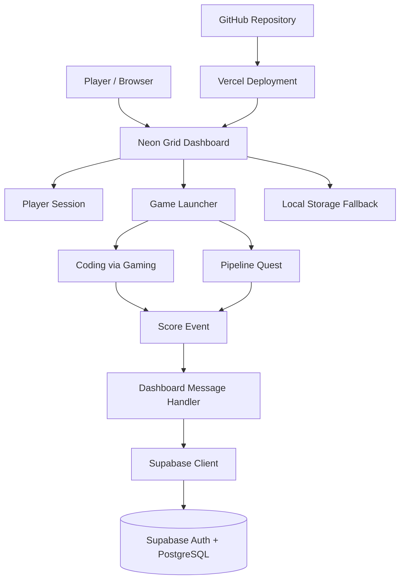

# ⚡ NEON GRID
### A Cyberpunk Gaming Hub · Two Games · One Player Identity · Cloud-Saved Progress

<p align="center">
  <strong>ENTER THE GRID. PLAY THE GAMES. BUILD YOUR LEGACY.</strong>
</p>

<p align="center">
  <a href="https://neon-grid-gaming-hub.vercel.app/">🌐 Live Demo</a> ·
  <a href="#-features">Features</a> ·
  <a href="#-getting-started">Getting Started</a> ·
  <a href="#-architecture">Architecture</a> ·
  <a href="#-security">Security</a>
</p>

---

**NEON GRID** is a futuristic, browser-based gaming hub that brings standalone games together under one cyberpunk-inspired interface. Players enter with a custom callsign, launch games from a unified dashboard, and track their performance through player profiles, score history, and personal bests.

Built with vanilla HTML, CSS, and JavaScript, backed by Supabase and deployed on Vercel, Neon Grid demonstrates how independent browser games can be integrated into a single web application with persistent player data and a shared launch experience.

**Live application:** https://neon-grid-gaming-hub.vercel.app/

---

## 🎮 The Experience

| Game | Description |
|---|---|
| **Coding via Gaming** | A coding-focused game experience with score reporting integrated into the hub. |
| **Pipeline Quest — Kestrel 9** | A mission-based game with score reporting when a run ends, including signal-loss scenarios. |

Both games are launched from the dashboard and displayed inside an iframe-based game interface, allowing players to return to the hub without navigating away from the application.

## ✨ Features

### 🕹️ Unified Gaming Dashboard
- Cyberpunk-inspired visual design with neon accents and glassmorphism.
- Centralized launcher for multiple standalone games.
- In-app game interface with a return-to-hub workflow.
- Player-tag entry and a unified gaming identity.

### 👤 Player Profiles
- Supabase anonymous authentication for browser-based player sessions.
- Custom display names, independent of authentication IDs.
- Player records associated with authenticated user IDs.
- Local browser storage fallback when cloud integration is unavailable.

### 📊 Score Tracking and History
- Game-specific score reporting.
- Persistent score records in Supabase.
- Score history and personal-best statistics in the dashboard.
- Game-to-dashboard communication through browser messaging.

### ☁️ Cloud-Connected Architecture
- Supabase for authentication and persistent data.
- PostgreSQL tables for player profiles and game-score events.
- Row Level Security (RLS) policies for database access control.
- Vercel hosting with Git-based deployments.

> **Current scope:** Neon Grid is a functional browser-gaming project and deployment-ready foundation. It does not currently provide server-validated competitive scores, guaranteed account recovery, or cheat-proof leaderboards.

---

## 🧰 Tech Stack

| Layer | Technology | Responsibility |
|---|---|---|
| Frontend | HTML5 | Page structure and game interfaces |
| Styling | CSS3 | Responsive layouts, visual effects, cyberpunk UI |
| Application logic | Vanilla JavaScript | Dashboard behavior, game launching, score handling |
| Game integration | HTML iframe + `postMessage` | Embedding games and communicating score events |
| Authentication | Supabase Auth | Anonymous player sessions |
| Database | Supabase / PostgreSQL | Player profiles and score history |
| Database security | Supabase RLS | Row-level access policies |
| Hosting | Vercel | Public deployment and static asset delivery |
| Version control | Git + GitHub | Source control and deployment workflow |

No frontend framework or application build step is required for the current static implementation.

---

## 🏗️ Architecture



### How it works

1. A player opens the dashboard and enters a player tag.
2. The dashboard establishes or retrieves an anonymous Supabase session when cloud authentication is configured.
3. The selected game opens inside the dashboard's iframe.
4. When a supported game reaches a score-reporting point, it sends a structured message to the parent dashboard.
5. The dashboard validates the message's origin and iframe context before processing it.
6. The score is submitted to Supabase, where database policies determine whether the operation is permitted.
7. The dashboard refreshes its score history and statistics.

When cloud configuration is absent, the application can use browser-local storage instead. Local records are not automatically migrated to Supabase.

---

## 📁 Project Structure

```text
neon-grid-gaming-hub/
├── dashboard/
│   ├── index.html              # Main hub and game launcher
│   ├── styles.css              # Cyberpunk dashboard styling
│   └── app.js                  # Player sessions, scores and integration
│
├── games/
│   ├── coding-game/
│   │   └── index.html          # Coding via Gaming
│   │
│   └── pipeline-quest/
│       ├── index.html          # Pipeline Quest entry point
│       ├── css/
│       │   └── style.css       # Game styles
│       └── js/
│           └── game.js         # Game mechanics and score reporting
│
├── supabase-setup.sql          # Database schema and RLS policies
├── vercel.json                 # Root URL redirect configuration
├── README.md
└── .gitignore
```

---

## 🚀 Getting Started

Run Neon Grid locally before making changes or deploying your own version.

### Prerequisites

- [Git](https://git-scm.com/)
- [Python 3](https://www.python.org/) for the local development server
- A modern browser
- [Supabase](https://supabase.com/) account for cloud persistence (optional for local demo mode)

### 1. Clone the repository

Replace the repository URL below with the HTTPS URL of this GitHub repository.

```bash
git clone </github.com/ojas-v/neon-grid-gaming-hub>
cd neon-grid-gaming-hub
```

Alternatively, download the repository as a ZIP and extract it.

### 2. Start the local server

Run the following command from the project root:

```bash
python -m http.server 8000
```

Open the dashboard in your browser:

**http://localhost:8000/dashboard/**

Keep the terminal running while you use the application. Press `Ctrl + C` to stop the server.

> Avoid opening the dashboard directly through a `file://` URL. Serving the project over HTTP provides a consistent origin for the dashboard and its embedded games.

### 3. Explore the application

- Enter a player tag.
- Launch either game from the dashboard.
- Complete a level or finish a run.
- Return to the hub and inspect the score history.
- Refresh the dashboard to check whether the player session and records persist.

Cloud persistence requires the Supabase configuration described below.

---

## 🗄️ Supabase Setup

Supabase provides anonymous authentication and persistent storage for player profiles and score events.

### 1. Create the database schema

1. Create a project at [Supabase](https://supabase.com/).
2. Open **SQL Editor**.
3. Create a new query.
4. Copy the contents of `supabase-setup.sql` into the editor.
5. Run the script.
6. Open **Table Editor** and confirm that the following tables exist.

| Table | Purpose |
|---|---|
| `players` | Stores player identifiers and display names |
| `game_scores` | Stores game-score events and timestamps |

A SQL Editor message saying **“Success. No rows returned”** is normal for statements that create database objects and policies. Verify the tables in Table Editor to confirm the setup.

### 2. Enable anonymous authentication

In your Supabase project:

1. Open **Authentication**.
2. Find the sign-in provider settings.
3. Enable **Anonymous Sign-Ins**.
4. Save the configuration if prompted.

Anonymous authentication provides an authenticated user ID without requiring an email-based registration flow. It does not, by itself, provide account recovery or a permanent identity across browsers and devices.

### 3. Configure the frontend

Open `dashboard/app.js` and locate the Supabase configuration constants:

```javascript
const SUPABASE_URL = "";
const SUPABASE_ANON_KEY = "";
```

Set them to your own project's values:

```javascript
const SUPABASE_URL = "https://YOUR_PROJECT_REF.supabase.co";
const SUPABASE_ANON_KEY = "YOUR_PUBLISHABLE_KEY";
```

Use the Project URL and **publishable key** from your Supabase project settings. The legacy `anon` key may also be supported by this setup.

Do not put a `service_role` key or any secret key in frontend JavaScript.

### 4. Verify cloud persistence

1. Save `dashboard/app.js`.
2. Reload the dashboard.
3. Enter a player tag.
4. Complete a game event that reports a score.
5. Open Supabase Table Editor and inspect `players` and `game_scores`.

A connected status indicator alone is not proof that database writes succeeded. Verify the actual rows and check the browser console if something fails.

---

## 🔌 Game-to-Dashboard Integration

Neon Grid uses `window.postMessage` to let an embedded game report score events to its parent dashboard.

A compatible game can send an event resembling the following from its actual score-reporting point:

```javascript
window.parent.postMessage(
  {
    type: "GAME_SCORE",
    gameId: "pipeline-quest",
    score: finalScore,
    maxScore: null,
    detail: "Mission complete"
  },
  window.location.origin
);
```

Replace `finalScore` with the game's actual score variable and report an appropriate event description. Use a numeric `maxScore` only if the game's scoring rules define a genuine maximum.

The dashboard should validate the message origin, expected iframe source, event type, and payload fields before processing a score.

### Adding another game

1. Add the game's files under `games/<game-name>/`.
2. Add a launcher entry to the dashboard.
3. Ensure the game loads correctly inside the existing iframe workflow.
4. Implement score reporting at genuine completion or scoring points.
5. Test the origin checks, score submission, and return-to-hub behavior.
6. Verify database records and dashboard statistics before deploying.

**Important:** `postMessage` integration is a communication mechanism, not proof that a score is legitimate. A player can manipulate client-side JavaScript and submitted messages.

---

## 🌐 Deployment on Vercel

The live project is hosted at:

**https://neon-grid-gaming-hub.vercel.app/**

To deploy your own changes:

1. Commit and push the updated files to the repository's connected production branch.
2. Let Vercel build and deploy the new revision.
3. Check the deployment status in Vercel.
4. Open the public URL and test the updated dashboard and games.

The current project is static and does not require a frontend build command. The `vercel.json` configuration redirects the root URL to `/dashboard/`.

Supabase configuration currently resides in frontend JavaScript. Vercel environment variables do not automatically replace hard-coded JavaScript constants unless the project is changed to generate or inject that configuration.

---

## 🔐 Security

Neon Grid uses client-side game logic and anonymous authentication. These choices keep the project simple to run, but they introduce limitations that matter when the site is publicly accessible.

### Current safeguards

- Supabase Row Level Security policies are defined in the setup script.
- Anonymous users receive authenticated session identities.
- The dashboard checks the origin and iframe context of score messages.
- Frontend configuration is intended to use the public Supabase publishable key.

### Known limitations

- **Scores are client-reported.** A modified browser can submit fabricated scores.
- **Player tags are display names.** They are not proof of a player's real-world identity.
- **Anonymous identities can be lost.** Clearing browser storage or changing devices can create a different session.
- **Public configuration is visible.** Supabase URLs and publishable keys are not secrets; database permissions must enforce access restrictions.
- **RLS does not validate game results.** It controls database access but does not establish that a reported score was honestly earned.

### Recommended hardening for a competitive public leaderboard

- Validate score submissions on a trusted backend or Supabase Edge Function.
- Enforce per-user ownership, input validation, reasonable limits, and game-specific constraints.
- Prevent users from arbitrarily editing or deleting other players' records.
- Add appropriate rate limiting and abuse monitoring.
- Review authentication, session recovery, and database policies before expanding the player base.

Neon Grid is a functional project foundation, not an audited or cheat-proof competitive gaming service.

---

## 🛠️ Troubleshooting

| Problem | What to check |
|---|---|
| SQL reports “Success. No rows returned” | Check Table Editor for `players` and `game_scores`. |
| Dashboard uses local demo mode | Verify the Supabase URL, publishable key, and Supabase client loading. |
| Player profile isn't saved | Check anonymous sign-in and the `players` table policies. |
| Score isn't saved | Inspect browser DevTools → Console and the `game_scores` policies. |
| Game doesn't load | Start the server from the project root and open `/dashboard/`. |
| Game opens but score history doesn't update | Inspect the score-reporting event, dashboard message handler, and Supabase response. |
| Local scores don't appear in Supabase | Local storage records are separate from cloud records and are not automatically migrated. |
| Pipeline Quest doesn't prefill the player callsign | Enter a callsign manually and inspect the launch URL if needed. |
| Vercel deployment fails | Review the deployment logs, repository structure, and static output settings. |

---

## 🗺️ Roadmap

Potential next steps for the project:

- [ ] Global leaderboard with server-validated scores
- [ ] Persistent, recoverable player accounts
- [ ] Achievements, player levels, and unlockable rewards
- [ ] More games integrated into the unified launcher
- [ ] Improved mobile layouts and touch controls
- [ ] Automated tests for score reporting and database permissions
- [ ] Preview deployments for feature branches
- [ ] Better observability for failed score submissions

These are planned improvements, not claims about features currently implemented.

---

## 💡 Design Principles

Neon Grid is built around a few straightforward ideas:

- **One hub, multiple experiences:** games remain independently organized while sharing a launcher and player interface.
- **Simple web technologies:** the core application uses HTML, CSS, and JavaScript without a mandatory framework build pipeline.
- **Persistent progression:** cloud-backed records make player history possible across reloads and browser sessions associated with the same identity.
- **Incremental development:** games can be added and improved without redesigning the entire application.
- **Security by design:** client-side convenience should not be confused with trusted score validation.

---

## 📜 License

No license is specified here. Before accepting contributions or inviting others to reuse the code, add a license that reflects how you want the project to be used.

---

<p align="center">
  <strong>NEON GRID</strong><br>
  <em>Plug in. Play on. Leave your mark.</em>
</p>
